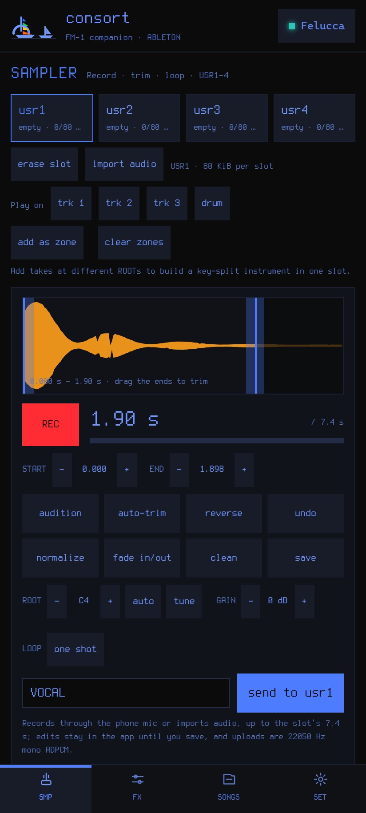
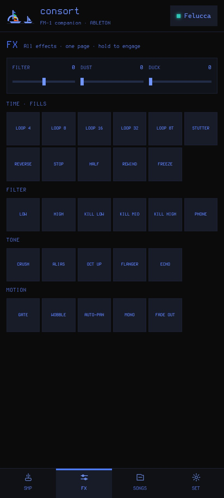
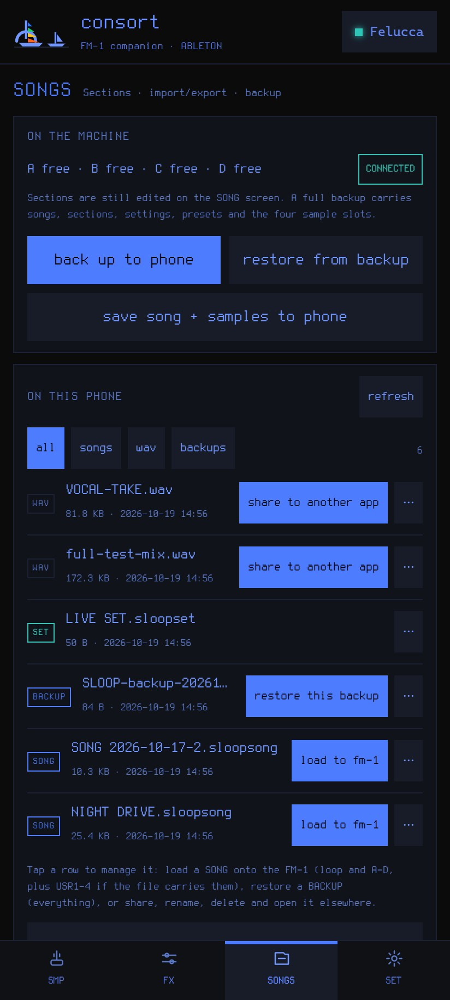
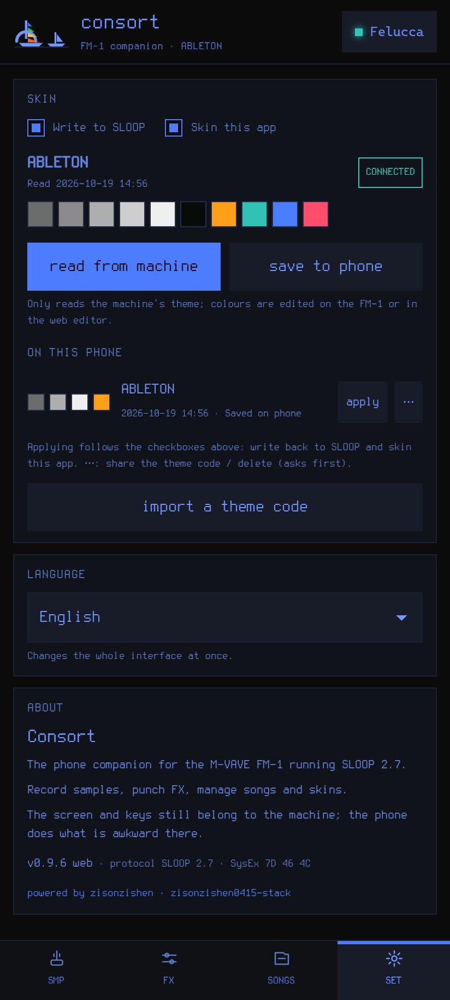

# Consort

[English](README.md) · [**简体中文**](README.zh-CN.md)

**用于运行 SLOOP 2.7 的 M-VAVE FM-1 的手机伴侣应用。** 它刻意保持范围很窄：只做在机器上操作起来麻烦的事，不碰乐器本身。

| 采样器 | FX |
| --- | --- |
|  |  |
| **歌曲与工程文件** | **设置、皮肤与语言** |
|  |  |

*截图：应用套用 FM-1 主题（ABLETON）。*

## 下载

[**下载最新 APK**](https://github.com/zisonzishen0415-stack/sloop-consort/releases/latest) — 侧载安装；Android 会要求允许从浏览器或文件管理器安装。APK 使用项目调试密钥签名（不是 Play 商店版本）。需要 Android 6.0+（minSdk 23）和 USB Host / OTG。

## 范围：只做 SLOOP 做起来麻烦的事

FM-1 仍然是乐器。Consort 是额外的一双手：

1. **外置采样器与采样管理。** 通过手机麦克风录音或导入音频文件（最长约 7.4 秒/槽位），录音时实时显示波形；拖动或在 10 ms 步进下裁剪，并对齐零交叉；自动裁剪、归一化、反向、设置循环模式（ONE SHOT / LOOP / LOOP+TAIL），循环点对齐零交叉并支持交叉淡化；去除直流/低频噪声；检测根音（AUTO），可选地把采样重调到根音（TUNE）；撤销；命名并发送到 USR1–4。一段录音可以按当前 ROOT 添加为一个 zone，最多 16 个 zone 写入同一个槽位，组成按键分区乐器；之后可以把该槽位挂到轨道 1–3，或在同一页把它用作鼓组。带 `smpl` 循环块的 WAV 打开时会自动设置循环，保存的 WAV 也会带回循环点。录音以 WAV 留在手机上，可从 Recent takes 列表重新打开；槽位可以在同一页查看和擦除。
2. **不用组合键的插入式 FX。** 全部 27 个效果在一个密集页面上，按 time、filter、tone、motion 分组。按住 pad 启用，松开释放；总 FILTER / DUST / DUCK 滑块在上方。
3. **工程文件。** FM-1 只保留一个工程；Consort 把它完整备份到手机（并写到 `Download/SLOOP` 下的 JSON 文件）并恢复，包括四个采样槽位。Songs 页也是手机端的 `.sloopsong`、`.sloopset` 和备份文件库：把歌曲载入 FM-1、恢复备份、从 Downloads 导入、分享、重命名、删除或在其他应用中打开。保存歌曲时会一次性完整捕获：loop、A–D 段落、顺序和 USR1–4。库中保留这一份母本文件；分享时按对方需要生成：标准 `.sloopsong`、完整 `.sloopsong`，或只含一首歌的 `.sloopset`。
4. **主题同步。** 从机器读取当前主题，保存到手机，写回，并让应用皮肤使用同一套颜色。主题也可以分享码的形式传播。

其他都留在该在的地方：音序、段落和 pattern 在 FM-1 的 SONG 屏幕；音色设计在 FM-1 或 web editor。这不是替代编辑器。

## 更多细节

- **采样器** — IMA ADPCM、22050 Hz 单声道，通过 SLOOP 使用的同一条 USB MIDI 链路写入；槽位自身的 81408 字节容量是上限（22050 Hz 下约 7.38 s），导入文件同样受限；22050 Hz 转换遵循 `sampleio.resample` 的移动平均抗混叠和线性插值。槽位方块跟随 `SMP_INFO` 的数量（SLOOP 2.4 起为 USR1–4；更早固件报告三个），所以页面与所连机器一致。录音时波形由 `AnalyserNode` 实时绘制（编码流在结束前无法解码）；结束后变为填充的 min/max 包络，裁剪范围之外的部分变暗。试听或渲染时，裁剪和增益以非破坏方式应用。LOOP 控件循环 SLOOP 的三种 zone 状态：ONE SHOT、LOOP（按住键时整个裁剪循环）和 LOOP+TAIL（按住时循环 start/end 点，松开后剩余采样作为尾音播放）。LOOP+TAIL 的两个点以 10 ms 步进设置，并切在零交叉上。one-shot 默认 15 ms 淡入/淡出（Consort 的编辑，槽位没有 fade 字段，可设为 0）；loop 不加 fade（否则每次回绕都会掉电平），如果设置了 crossfade，则把尾部折叠到循环起点，循环终点放在该尾部之前——机器上的 zone 标志 2（SLOOP 2.6 作为 always-loop 播放）。循环起点还携带该采样处的 IMA 预测器/索引，这是固件回绕时恢复的状态，所以从非零位置开始的循环不会咔哒。带根音的录音可以添加为 zone；zone 按根音排序，键盘在相邻根音中间分割（上游 `key_split`），共享槽位的数据预算，因此最多 16 个 zone 或总共约 7.4 s。Auto-trim、normalize、reverse、clean 和 TUNE 都会生成新缓冲区，所以 Undo 可以回退。AUTO 只用检测到的音高给录音打标签（不改音频，这是机器根音键想要的）；TUNE 是可选的破坏性操作：重采样录音使其自身音高等于 ROOT，拒绝超过 ±2 八度或结果超过 7 s 的操作，并相应改变时长。Save 把裁剪后的 22050 Hz WAV 渲染到 `Download/SLOOP`，循环时带 `smpl` 块；import 会读回同一个块，所以循环点能往返。导入的 `smpl` 循环会变成带这些点的 LOOP+TAIL，即使循环到结尾也如此，这正是上游编辑器的导入方式。ROOT 覆盖完整的 0–127 范围。电平保持录制时的值：上游 Python CLI 会把每个 zone 峰值归一化到 30000，但那是 CLI 约定而不是槽位规则（header 没有 gain 字段），web editor 使用每文件 gain；Consort 提供 GAIN 和可选的 NORM。全速率可编辑录音（PCM 加 trim/root/loop/fade）也保存在 IndexedDB，所以点按录音即使应用重启也能重新打开。Play on track 1–3 会选择轨道、切换到 SAMPLE 引擎及其默认音色（上游编辑器也这样做）、把 SET 设为该槽位并恢复选择；DRUM 则设置鼓轨的 KIT。刻意不做：变调/时间拉伸；逐键鼓垫在上游 web editor 中制作。
- **FX** — LIVE op 3，按住/松开，效果不会卡住。名称沿用机器本身的命名。
- **歌曲** — PROJECT 用于段落状态；backup objects 用于完整状态。备份同时写到应用内和 JSON 文件，所以清空 WebView 存储也不会丢。可以从手机库、最近五个应用内备份或文件恢复。USR1–4 是全局 flash 槽位，所有歌曲共享。Consort 的母本歌曲文件仍是 `.sloopsong`，但在 `objects` 旁增加顶层 `samples` 数组（id 32–35）；载入时也会恢复这些槽位。分享时生成三种形态而不改母本：标准 `.sloopsong`（仅 loop、A–D 和顺序，兼容上游）、完整 `.sloopsong`，或单曲 `.sloopset` 播放列表（采样作为不透明数据随行）。上游 SLOOP 编辑器忽略未知顶层字段，所以仍能载入歌曲，但不会应用采样，并在那边重新保存时丢弃它们。完整备份仍是包含采样槽位在内的完整可恢复快照。**离线渲染：** SONG 或 BACKUP 可以在手机上渲染成 44.1 kHz 立体声 WAV——完整的 SLOOP 2.7.1 固件以 WebAssembly 运行，速度高于实时，所以不需要 FM-1。带 A–D 顺序的歌曲会完整渲染一遍 arrangement；没有顺序的文件渲染当前 loop（可选择时长）。WAV 写到 `Download/SLOOP`，并出现在同一个库的 **WAV** 筛选下，可分享、重命名、打开或删除。
- **皮肤与设置** — 主题是 FM-1 上的 object 11（THM2）；应用从它推导调色板并提升对比度，保证文字可读。八种界面语言，默认英文。
- 不改固件。FM-1 通过 Android USB MIDI（`android.media.midi`）访问，不是 Web MIDI。手机需要 USB Host / OTG；FM-1 的 USB 口必须是暴露 MIDI 的那个。

## 构建

需要 Android SDK（build-tools 和 platform）、JDK 17，以及能运行 `aapt2`、`javac`、`d8`、`zipalign` 和 `apksigner` 的 shell。

    bash android/build.sh

签名的 APK 写到项目根目录的 `consort.apk`（以及 `android/consort.apk`）。`About` 显示包版本；构建脚本把时间写进版本名，因此可以区分侧载测试构建。

## 无硬件预览

    python -m http.server 8765
    # open http://127.0.0.1:8765/index.html

没有 native bridge 时页面连接 mock FM-1，所以整个 UI 和协议流程可以在浏览器中演练。传输是模拟的；此模式不会写 `Download/SLOOP`。

## 协议

SLOOP 2.7 over USB MIDI：`F0 7D 46 4C <cmd> <7-bit args> F7`。帧、请求/响应、备份对象、主题（THM2）、采样槽位（SMP、IMA ADPCM）、描述符（DESC）、轨道（TRACK、TRACK_PARAM）以及 "Play on" 背后的 engine/KIT 分配都在 `protocol.js`。

```
index.html   四个页面和 banner
theme.css    SLOOP 的视觉语言（Terminus、方形控件）
i18n.js      八种界面语言
protocol.js  帧、Link、备份对象、.sloopsong、主题、SMP、DESC/TRACK
app.js       皮肤、FX、歌曲、设置
samples.js   采样器
android/     WebView shell、本地服务器、USB MIDI bridge、文件 bridge
```

## 用虚拟 FM-1 测试

APK 可以针对**真实的 SLOOP 固件**运行，而无需真机，通过 `tools/vfm1/` 中的小型虚拟 MIDI rig：一个 Android `MidiDeviceService` 发布名为 `Felucca` 的设备，主机端的固件构建（浏览器模拟器环境加 `editor.c`）响应相同的 SysEx。采样器、FX、主题、备份和恢复路径就是这样端到端验证的。见 [tools/vfm1/README.md](tools/vfm1/README.md)。

## 状态

已在真机 FM-1 上端到端验证：INFO、采样编码/上传到 USR 和擦除、FX 按下/松开、全局 SET、主题读取/保存/写回和皮肤、备份到 `Download/SLOOP` 并恢复（含采样），以及通过手机库保存/载入 `.sloopsong`。循环点、三种循环状态、`smpl` 往返、多 zone header 和 TRACK/KIT 分配也在脚本化的 SLOOP 2.7 设备上检查过；zone 和 engine 编号从 `DESC`/`INFO` 解析，不是硬编码。欢迎反馈 bug。

## 致谢与许可

- **SLOOP** 由 3dSam 制作，基于 Leo Kuroshita (@kurogedelic) / **Hügelton Instruments** 的 **[Felucca](https://github.com/hugelton/Felucca)**。这是独立伴侣应用：不含固件，与上述项目无隶属关系。
- M-VAVE FM-1 归其所有者所有。
- 代码为 GPL-3.0-only（见 `LICENSE`），与开发时参考的 SLOOP 编辑器源码一致。
- Terminus 字体为 SIL OFL 1.1；见 `LICENSES/Terminus-OFL.txt`。
- 离线渲染器内嵌编译成 WebAssembly 的 SLOOP 2.7.1 固件（`sloop.wasm`，GPL-3.0）；它由 SLOOP 源码构建，运行与 FM-1 相同的 DSP。
